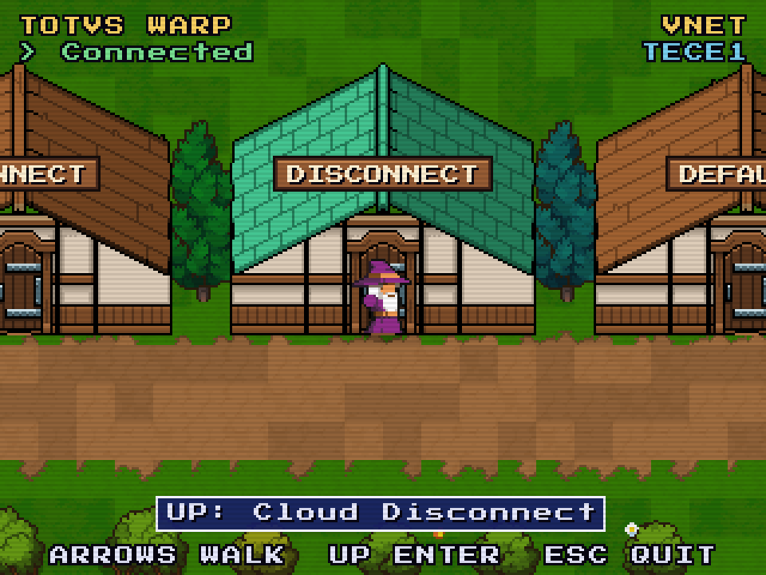

# TOTVS WARP — Village Menu

Menu gráfico em estilo 16-bit para controlar o **Cloudflare WARP** na TOTVS. Em vez de uma lista de opções, você conduz um mago por uma vila: cada taverna é uma ação do WARP, e basta entrar pela porta para executá-la.



| Taverna | Ação executada |
|---|---|
| `CONNECT` | `warp-cli connect` |
| `DISCONNECT` | `warp-cli disconnect` (pede confirmação) |
| `DEFAULT` · `TESP2` · `TECE1` | `warp-cli vnet <uuid>`: troca a rede virtual |

O status atual da conexão e a vnet selecionada aparecem no topo da tela e são atualizados a cada 2 segundos.

---

## Sumário

- [Recursos](#recursos)
- [Requisitos](#requisitos)
- [Instalação](#instalação)
- [Execução](#execução)
- [Controles](#controles)
- [Configuração](#configuração)
- [Desenvolvimento](#desenvolvimento)
- [Solução de problemas](#solução-de-problemas)
- [Estrutura do projeto](#estrutura-do-projeto)
- [Créditos e licenças](#créditos-e-licenças)

---

## Recursos

- **Vila top-down 16-bit:** rua com rolagem horizontal, tavernas, árvores, fogueira animada e um mago com animações de parado e de corrida.
- **Renderização pixel-perfect:** o jogo é desenhado em 320×240 e ampliado por um fator inteiro, sem borrar os pixels. A janela pode ser redimensionada.
- **Interface sem travamentos:** os comandos do `warp-cli` rodam em threads separadas, então a animação nunca congela.
- **Movimento suave:** o ritmo dos quadros segue o vsync do monitor e a lógica avança em passos fixos de 1/60 s.
- **Som procedural:** efeitos chiptune gerados em código (sem arquivos de áudio), mais uma música de fundo opcional.
- **Vnets dinâmicas:** adicionar uma vnet cria automaticamente uma nova taverna, e a rua cresce junto.


---

## Requisitos

| Requisito | Detalhe |
|---|---|
| Sistema | Linux com sessão gráfica (X11 ou Wayland via XWayland). Testado no Ubuntu com GNOME. |
| Cloudflare WARP | `warp-cli` instalado, registrado e disponível no `PATH`. |
| Compilação | CMake ≥ 3.16, compilador C++17 (GCC ou Clang), `git` |
| Bibliotecas | Cabeçalhos de OpenGL, X11 e ALSA (veja abaixo) |

A biblioteca gráfica [raylib 5.5](https://www.raylib.com/) é baixada e compilada automaticamente na primeira compilação. Não é preciso instalá-la no sistema.

---

## Instalação

### 1. Instale as dependências do sistema

Debian / Ubuntu:

```bash
sudo apt-get update
sudo apt-get install -y git cmake build-essential pkg-config \
  libgl1-mesa-dev libx11-dev libxrandr-dev libxi-dev \
  libxinerama-dev libxcursor-dev libasound2-dev
```

### 2. Verifique o Cloudflare WARP

O menu apenas executa o `warp-cli`, então ele precisa já estar funcionando:

```bash
warp-cli status
```

Se o comando não existir, instale o cliente seguindo a [documentação da Cloudflare](https://developers.cloudflare.com/warp-client/get-started/linux/) e faça o registro na organização da TOTVS.

### 3. Clone o repositório

```bash
git clone git@github.com:chmenegatti/warp-menu.git
cd warp-menu
```

> O repositório é privado. É preciso ter acesso a ele e uma chave SSH cadastrada no GitHub.

### 4. Compile

```bash
cmake -S . -B build -DCMAKE_BUILD_TYPE=Release
cmake --build build -j"$(nproc)"
```

A primeira compilação baixa e compila a raylib (pode levar alguns minutos). As seguintes levam poucos segundos.

> Esse passo é opcional: o `./warp.sh` compila sozinho na primeira execução.

### 5. (Opcional) Deixe o comando `warp` disponível em qualquer pasta

```bash
mkdir -p ~/.local/bin
ln -sf "$PWD/warp.sh" ~/.local/bin/warp
```

Confirme que `~/.local/bin` está no seu `PATH`:

```bash
echo "$PATH" | tr ':' '\n' | grep -x "$HOME/.local/bin"
```

Se não aparecer nada, adicione ao `~/.bashrc` ou `~/.zshrc`:

```bash
export PATH="$HOME/.local/bin:$PATH"
```

---

## Execução

```bash
warp            # se você fez o passo 5
./warp.sh       # a partir da pasta do projeto
```

O `warp.sh` verifica se o binário existe e se o código mudou desde a última compilação. Se precisar, recompila antes de abrir o menu.

### Fluxo de uso

1. Ande com o mago pela rua até a porta da taverna desejada. Uma caixa `UP: <ação>` mostra o que a taverna faz.
2. Pressione **↑** para entrar. A ação é executada e uma janela mostra `WORKING...`, depois `SUCCESS` ou `FAILED`.
3. Depois de **conectar** ou **trocar de vnet** com sucesso, o menu fecha sozinho.
4. Depois de **desconectar**, ou se algo falhar, o mago sai da taverna e você pode escolher outra ação.
5. Para sair sem fazer nada, pressione **Esc** ou ande até a placa `EXIT>` no fim da rua.

---

## Controles

| Tecla | Ação |
|---|---|
| ← → ↑ ↓ ou W A S D | Andar |
| ↑ (na frente da porta) | Entrar na taverna e executar a ação |
| ← → (na confirmação) | Alternar entre `NO` e `YES` |
| Enter / Espaço | Confirmar ou fechar a mensagem de resultado |
| Esc / Q | Sair do menu |

---

## Configuração

### Adicionar ou alterar vnets

As vnets ficam em `src/warp.cpp`, no construtor do `WarpController`:

```cpp
vnets_ = {
    {"default", "51d02f9b-41ec-4b0a-8691-072aa331acff"},
    {"TESP2",   "a61c9382-38d9-488d-b735-a927532bb006"},
    {"TECE1",   "55f51d19-3faf-43d9-9ddc-646a557edd1f"},
};
```

Adicione uma linha `{"NOME", "uuid"}` e rode `warp` de novo. O menu recompila sozinho e cria uma taverna nova com o nome em maiúsculas. Os UUIDs das redes virtuais da organização aparecem na saída de `warp-cli vnet`.

### Música de fundo (opcional)

Coloque um arquivo em `assets/music/` com um destes nomes:

```
theme.ogg   theme.xm   theme.mod   theme.mp3
```

Módulos tracker (`.xm` / `.mod`) tocam nativamente e combinam com o estilo chiptune. Sem arquivo, o menu roda só com os efeitos sonoros.

### Variáveis de ambiente

| Variável | Efeito |
|---|---|
| `WARP_DEBUG=1` | Mostra o log completo da raylib no terminal (por padrão aparecem só avisos e erros). |
| `WARP_SNAPSHOT=/caminho/img.png` | Renderiza ~1 s, salva a tela (320×240) em PNG e fecha, sem executar nenhuma ação do WARP. |
| `WARP_SNAPSHOT_WIZ=x,y` | Junto com `WARP_SNAPSHOT`, posiciona o mago antes do print (coordenadas do mundo, nos pés). |

---

## Desenvolvimento

```bash
cmake --build build -j          # recompilação incremental
./build/warp-menu               # executa o binário diretamente
```

- Não há suíte de testes. A compilação com `-Wall -Wextra` é a verificação automática.
- Para conferir mudanças visuais sem interagir (e sem chamar o `warp-cli`), use o print de tela:

  ```bash
  WARP_SNAPSHOT=/tmp/porta.png WARP_SNAPSHOT_WIZ=392,141 ./build/warp-menu
  ```

- As chamadas ao `warp-cli` levam cerca de 0,3 s e devem ficar **fora da thread de render**. Use `WarpController::runAsync` para ações. O status já é consultado em segundo plano.
- Todas as coordenadas do jogo estão em pixels virtuais (tela de 320×240), não em pixels da janela.

Detalhes de arquitetura para quem vai mexer no código estão em [`CLAUDE.md`](CLAUDE.md).

---

## Solução de problemas

| Sintoma | Causa provável / solução |
|---|---|
| Status aparece como `Unknown` | O `warp-cli` não está no `PATH` ou o daemon do WARP não está rodando. Teste com `warp-cli status`. |
| Ação sempre termina em `FAILED` | Rode o mesmo comando manualmente (ex.: `warp-cli connect`) para ver o erro real do WARP. |
| Sem som | O projeto força o backend ALSA, porque o backend PulseAudio da raylib falha no PipeWire. Verifique se `aplay -l` lista dispositivos e se o pacote `pipewire-alsa` está instalado. |
| Erro de compilação sobre `GL/gl.h`, `X11/...` ou `alsa/...` | Faltam as dependências do [passo 1](#1-instale-as-dependências-do-sistema). |
| Janela não abre | O app é só gráfico e precisa de uma sessão X11/Wayland. Não funciona em SSH sem encaminhamento de display. |
| Menu antigo continua abrindo | O comando `warp` aponta para outro binário. Confira com `ls -l "$(command -v warp)"` e rode `hash -r`. |
| Fontes ou sprites ausentes | O caminho dos assets é gravado na compilação (`ASSETS_DIR`). Se você moveu a pasta do projeto, recompile: `rm -rf build && ./warp.sh`. |

---

## Estrutura do projeto

```
.
├── warp.sh                 # launcher: compila se necessário e executa
├── CMakeLists.txt          # baixa a raylib 5.5 via FetchContent
├── src/
│   ├── main.cpp            # janela, máquina de estados das telas, HUD
│   ├── town.{hpp,cpp}      # a vila: mapa, tavernas, mago, câmera
│   ├── warp.{hpp,cpp}      # integração com o warp-cli (threads)
│   ├── ui.{hpp,cpp}        # canvas 320×240, texto pixelado, painéis
│   └── audio.{hpp,cpp}     # efeitos sonoros procedurais e música
├── assets/
│   ├── font/               # Press Start 2P
│   ├── pixelcrawler/       # sprites (subconjunto do Pixel Crawler)
│   └── music/              # música de fundo opcional
└── docs/                   # imagens do README
```

---

## Créditos e licenças

- **Sprites:** [Pixel Crawler – Free Pack](https://anokolisa.itch.io/free-pixel-art-asset-pack-topdown-tileset-rpg-16x16-sprites), de **Anokolisa**. O uso em qualquer projeto é permitido, mas os sprites **não podem ser revendidos nem redistribuídos como pacote de assets**. Termos completos em [`assets/pixelcrawler/TERMS.pdf`](assets/pixelcrawler/TERMS.pdf). Por isso este repositório deve continuar **privado**.
- **Fonte:** [Press Start 2P](https://fonts.google.com/specimen/Press+Start+2P), de CodeMan38, sob a SIL Open Font License.
- **Biblioteca gráfica:** [raylib](https://www.raylib.com/), de Ramon Santamaria e colaboradores, sob a licença zlib/libpng.
- **Código:** uso interno TOTVS.
