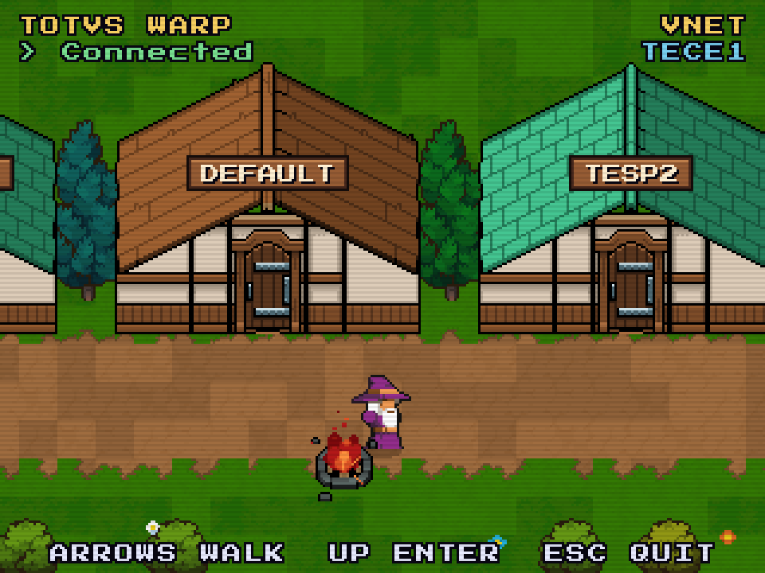

# TOTVS WARP — Village Menu

Menu gráfico em estilo 16-bit para controlar o **Cloudflare WARP** na TOTVS. Em vez de uma lista de opções, você conduz um mago por uma vila: cada taverna é uma ação do WARP, e basta entrar pela porta para executá-la.


| Taverna | Ação executada |
|---|---|
| `CONNECT` | `warp-cli connect` |
| `DISCONNECT` | `warp-cli disconnect` (pede confirmação) |
| `DEFAULT` · `TESP2` · `TECE1` | `warp-cli vnet <uuid>`: troca a rede virtual |

O status da conexão e a vnet selecionada aparecem no topo da tela e são atualizados a cada 2 segundos.

---

## Sumário

- [Instalação](#instalação)
- [Como usar](#como-usar)
- [Controles](#controles)
- [Configuração](#configuração)
- [Solução de problemas](#solução-de-problemas)
- [Para desenvolvedores](#para-desenvolvedores)
- [Recursos](#recursos)
- [Créditos e licenças](#créditos-e-licenças)

---

## Instalação

**Pré-requisito em todos os sistemas:** o cliente **Cloudflare WARP** precisa estar instalado e registrado na organização da TOTVS. O menu só executa o `warp-cli` do próprio cliente. Teste num terminal:

```
warp-cli status
```

Baixe o pacote do seu sistema na página de **[Releases](https://github.com/chmenegatti/warp-menu/releases/latest)** e siga o guia correspondente:

| Sistema | Arquivo | Guia |
|---|---|---|
| Ubuntu, Debian, Mint, Pop!_OS | `warp-menu_<versão>_amd64.deb` | [Instalação no Linux](docs/install/linux.md#ubuntu--debian-deb) |
| Fedora, RHEL, Rocky, Alma | `warp-menu-<versão>-1.x86_64.rpm` | [Instalação no Linux](docs/install/linux.md#fedora--rhel--rocky-rpm) |
| Windows 10 / 11 (64 bits) | `warp-menu-<versão>-windows-x64.zip` | [Instalação no Windows](docs/install/windows.md) |
| macOS 11 ou superior (Intel e Apple Silicon) | `warp-menu-<versão>-macos-universal.dmg` | [Instalação no macOS](docs/install/macos.md) |

Instalação rápida no Linux, já dentro da pasta onde o arquivo foi baixado:

```bash
sudo apt install ./warp-menu_*_amd64.deb        # Ubuntu / Debian
sudo dnf install ./warp-menu-*.x86_64.rpm       # Fedora / RHEL / Rocky
```

Para compilar a partir do código-fonte, veja [docs/building.md](docs/building.md).

---

## Como usar

Abra o **TOTVS WARP** pelo menu de aplicativos (Linux), pelo atalho (Windows) ou pela pasta Aplicativos (macOS). No Linux também dá para abrir pelo terminal com `warp-menu`.

1. Ao abrir, o mago sai da porta da taverna da vnet selecionada no momento.
2. Ande com o mago pela rua até a porta da taverna desejada. Uma caixa `UP: <ação>` mostra o que a taverna faz.
3. Pressione **↑** para entrar. A ação é executada e uma janela mostra `WORKING...`, depois `SUCCESS` ou `FAILED`.
4. Depois de **conectar** ou **trocar de vnet** com sucesso, o menu fecha sozinho.
5. Depois de **desconectar**, ou se algo falhar, o mago sai da taverna e você pode escolher outra ação.
6. Para sair sem fazer nada, pressione **Esc** ou ande até a placa `EXIT>` no fim da rua.



---

## Controles

| Tecla | Ação |
|---|---|
| ← → ↑ ↓ ou W A S D | Andar |
| ↑ (na frente da porta) | Entrar na taverna e executar a ação |
| ← → (na confirmação) | Alternar entre `NO` e `YES` |
| Enter / Espaço | Confirmar ou fechar a mensagem de resultado |
| Esc / Q | Sair do menu |

---

## Configuração

### Variáveis de ambiente

| Variável | Efeito |
|---|---|
| `WARP_CLI=/caminho/warp-cli` | Usa este `warp-cli` em vez de procurá-lo no `PATH` e nos locais padrão de instalação. |
| `WARP_DEBUG=1` | Mostra o log completo da raylib no terminal (por padrão aparecem só avisos e erros). |
| `WARP_SNAPSHOT=/caminho/img.png` | Renderiza ~1 s, salva a tela (320×240) em PNG e fecha, sem executar nenhuma ação do WARP. |
| `WARP_SNAPSHOT_WIZ=x,y` | Junto com `WARP_SNAPSHOT`, posiciona o mago antes do print (coordenadas do mundo, nos pés). |

O `warp-cli` é procurado primeiro no `PATH` e depois nos locais onde o instalador da Cloudflare o coloca: `/usr/bin`, `/usr/local/bin` e `/Applications/Cloudflare WARP.app` no Linux e macOS, e `C:\Program Files\Cloudflare\Cloudflare WARP` no Windows.

### Música de fundo (opcional)

Coloque um arquivo `theme.ogg`, `theme.xm`, `theme.mod` ou `theme.mp3` na pasta `assets/music/` da instalação:

| Sistema | Pasta |
|---|---|
| Linux (pacote) | `/usr/share/warp-menu/assets/music/` |
| Windows | `assets\music\` ao lado do `warp-menu.exe` |
| macOS | `TOTVS WARP.app/Contents/Resources/assets/music/` |

Módulos tracker (`.xm` / `.mod`) tocam nativamente e combinam com o estilo chiptune. Sem arquivo, o menu roda só com os efeitos sonoros.

### Vnets

As vnets ficam no código (`src/warp.cpp`). Para adicionar ou alterar uma, veja [docs/building.md](docs/building.md#adicionar-ou-alterar-vnets) e gere uma nova versão.

---

## Solução de problemas

| Sintoma | Causa provável / solução |
|---|---|
| Status aparece como `Unknown` | O app não achou o `warp-cli` ou o serviço do WARP não está rodando. Teste `warp-cli status` num terminal. Se o `warp-cli` estiver num local diferente, defina `WARP_CLI`. |
| Ação sempre termina em `FAILED` | Rode o mesmo comando manualmente (ex.: `warp-cli connect`) para ver o erro real do WARP. |
| A janela não abre ou fecha na hora | O app precisa de OpenGL 3.3. Máquinas virtuais sem aceleração gráfica e acessos remotos (RDP) podem não ter. Rode com `WARP_DEBUG=1` para ver o erro. |
| Sem som (Linux) | O app usa ALSA. Verifique se `aplay -l` lista dispositivos e se o pacote `pipewire-alsa` está instalado. |
| Windows: "O Windows protegeu o computador" | O executável não é assinado. Clique em **Mais informações → Executar assim mesmo**. Veja o [guia do Windows](docs/install/windows.md). |
| macOS: "não pode ser aberto" / "Apple não pôde verificar" | O app não é notarizado pela Apple. Veja como liberar no [guia do macOS](docs/install/macos.md). |

---

## Para desenvolvedores

- **Compilar, gerar pacotes e publicar uma versão:** [docs/building.md](docs/building.md)
- **Arquitetura do código:** [CLAUDE.md](CLAUDE.md)

```
.
├── src/                    # código C++ (main, town, warp, ui, audio)
├── assets/                 # fonte, sprites, ícone, música opcional
├── packaging/              # .desktop, ícones .ico/.icns, script dos pacotes Linux
├── .github/workflows/      # CI: compila os 3 sistemas e publica a Release
├── docs/                   # guias de instalação e imagens
├── warp.sh                 # launcher de desenvolvimento (Linux)
└── CMakeLists.txt          # build + CPack (deb/rpm)
```

---

## Recursos

- **Vila top-down 16-bit:** rua com rolagem horizontal, tavernas, árvores, fogueira animada e um mago com animações de parado e de corrida.
- **Renderização pixel-perfect:** o jogo é desenhado em 320×240 e ampliado por um fator inteiro, sem borrar os pixels. A janela pode ser redimensionada.
- **Interface sem travamentos:** os comandos do `warp-cli` rodam em threads separadas (no Windows, sem abrir janelas de console).
- **Movimento suave:** o ritmo dos quadros segue o vsync do monitor e a lógica avança em passos fixos de 1/60 s.
- **Som procedural:** efeitos chiptune gerados em código, mais uma música de fundo opcional.
- **Multiplataforma:** pacotes para Linux (`.deb` e `.rpm`), Windows e macOS, gerados automaticamente pelo GitHub Actions.

---

## Créditos e licenças

- **Sprites:** [Pixel Crawler – Free Pack](https://anokolisa.itch.io/free-pixel-art-asset-pack-topdown-tileset-rpg-16x16-sprites), de **Anokolisa**. O uso em projetos é livre e o crédito é opcional. Os sprites **não podem ser vendidos** nem comercializados como produto separado. Termos completos em [`assets/pixelcrawler/TERMS.pdf`](assets/pixelcrawler/TERMS.pdf).
- **Fonte:** [Press Start 2P](https://fonts.google.com/specimen/Press+Start+2P), de CodeMan38, sob a SIL Open Font License.
- **Biblioteca gráfica:** [raylib](https://www.raylib.com/), de Ramon Santamaria e colaboradores, sob a licença zlib/libpng.
- **Código:** uso interno TOTVS.
